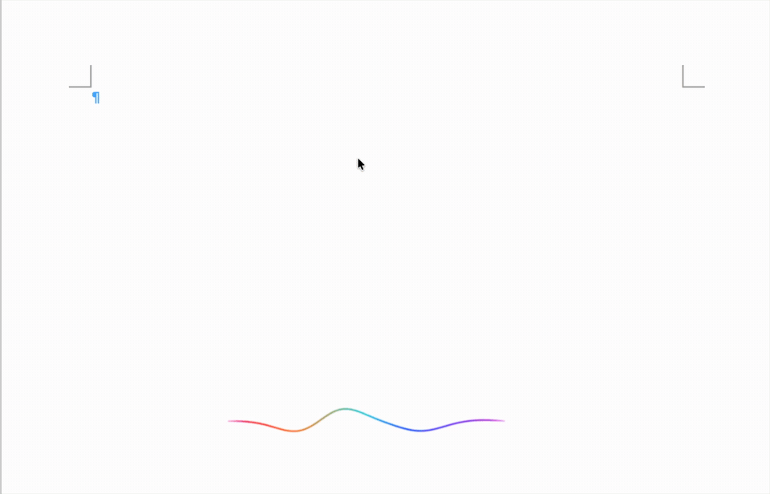

# WaveType

**Typeless-style AI voice input for macOS — ASR 100% local, LLM cleanup local or cloud (your choice).**
基于本地 MLX 模型的 Typeless 平替：语音转写、AI 清洗润色、波形 HUD、个人记忆。语音识别始终离线；润色层可切换本地 Ollama 或云端 OpenAI 兼容 API（如 DeepSeek）。

> Press `Fn`, speak, press `Fn` again — polished text types itself into any app.
> `Fn+Shift` translates between Chinese and English; `Fn+Space` lets you ask or edit with your voice.
> Audio never leaves your Mac.



## ✨ Features

- **Push-to-talk dictation** — tap `Fn` to start, tap again to finish; text is typed character-by-character via `CGEvent` Unicode injection (no clipboard, no IME interference, works in any app)
- **Translate mode** — tap `Fn+Shift`, speak naturally, tap `Fn` to finish: Chinese ↔ English translation is typed at the cursor. Terms, model numbers and standards codes (AM4205, IEC 60335-2-40…) are preserved as-is
- **Ask mode** — tap `Fn+Space`, speak a question or command, tap `Fn` to finish. Answers appear in a floating card (your text is never touched); select text first and speak an edit command ("make this more professional") and the selection gets rewritten in place
- **ASR stays local** — speech recognition always runs on-device via [Qwen3-ASR](https://huggingface.co/mlx-community/Qwen3-ASR-1.7B-8bit) (MLX, Apple Silicon native). The cleanup/translate/ask LLM can be a local Ollama model (fully offline) or an OpenAI-compatible cloud API (DeepSeek, Moonshot…) — only *text* ever leaves the machine
- **Waveform HUD** — a Siri-inspired floating energy line: appears from its center while listening, collapses back into the center when done; `Listening` / `Thinking` states with distinct motion & color treatment
- **Speech-gated visualization** — Silero VAD (onnxruntime, CPU) ensures only your voice drives the waveform; keyboard clicks, fans and door slams leave it perfectly flat. Visual gating only — ASR always receives the untouched raw audio
- **Personal memory** — it learns from your corrections **automatically**: after typing, WaveType watches the target field (Accessibility API, ~60s window); if you edit what it wrote, the correction pair is diffed out and stored in a local SQLite dictionary, then immediately re-injected as ASR hotwords + LLM constraints. No gestures needed. (For apps where AX readback fails — WeChat/WeCom and other non-native UIs — select the corrected text and tap `Ctrl+Fn` instead; both paths now report success *and* failure on the HUD, and log the reason.) The more you use it, the fewer mistakes it makes
  - What gets learned: same-position replacements — homophone terms (`巨龙`→`居隆`), units and symbols (`度`→`℃`, `瓦`→`W`, `兆`→`MB`), numerals (`六百`→`600`)
  - What is deliberately *not* learned: pure insertions/deletions (spacing edits, duplicate-word deletion) — a `wrong → right` table cannot express them without over-generalising, and the polish prompt already handles stutter. A quality gate (`voice_input/memory.py:is_learnable`) rejects noise like `5 → 5℃` or `我 → 你`, which would otherwise be enforced globally as "必须严格遵守"
  - `python3 main.py dict` lists entries and the ASR hotwords currently injected
- **Plain-text lists** — spoken enumerations become `1. 2. 3.` numbered lists with Tab indentation. No Markdown symbols leaking into your input fields — *unless* the target supports it: in Markdown-capable apps (Obsidian, Typora, Notion, 飞书… configurable via `markdown_apps`) lists and **bold** are emitted natively
- **Cursor context awareness** — the polisher sees the text around your cursor (read at recording start via AX): replies don't re-greet the sender, enumerations continue the preceding list's numbering, and a leading punctuation dedup rule prevents `。。` seams at the junction
- **Voice commands** — a whole-utterance match like `换行`, `撤销`, `全选`, `保存` sends the keystroke directly (never reaches the LLM); `换行换行` presses Return twice. Disable with `commands: false`
- **Style profile** — every edit you make after injection is logged locally (`style_edits` table); once enough samples accumulate, a local distillation pass (`python3 main.py style`, or automatic) summarizes abstract preferences ("聊天：偏好短句") — never the raw content — and injects them into the polish prompt. Typeless's `/user/traits`, fully on-device. Disable with `style.enabled: false`
- **Deterministic dictionary layer** — beyond ASR hotwords + LLM prompt constraints, learned pairs are also hard-applied as a final regex/substring pass (FluidVoice-style), so "LLM ignored the dictionary" can no longer leak through. `llm.hard_apply_dict: false` to opt out
- **Menu bar icon** — WaveType lives in the menu bar: recording status dot, dictionary/style stats, quick access to `config.yaml`, and Quit
- **Anti-hallucination guardrails** — fidelity-first prompt (deliberate repetition and courtesy words are kept, per FluidVoice's rules) + repetition-loop detection + length-ratio fallback to raw ASR output (relaxed automatically for mid-speech corrections and enumerations)

## 🎬 Demo

Tune the waveform animation without speaking:

```bash
python3 main.py --demo               # simulated mic levels
python3 main.py --demo --demo-secs 10
```

## 🚀 Install

Requirements: macOS on Apple Silicon, Python 3.11+. For the local LLM option: [Ollama](https://ollama.com); for the cloud option: a DeepSeek (or any OpenAI-compatible) API key.

```bash
git clone https://github.com/midearobin-beep/WaveType.git
cd WaveType
./start.sh   # first run: launches the GUI setup wizard (model choice → API key → hotkeys & permissions)
```

Manual setup, if you prefer:

```bash
python3 -m venv .venv && source .venv/bin/activate
pip install -r requirements.txt
cp config.example.yaml config.yaml   # llm.provider: openai (cloud) or ollama (local)
echo "DEEPSEEK_API_KEY=sk-xxx" > .env # cloud option only
python3 main.py --setup              # re-open the wizard anytime
```

### One-time macOS setup

1. **System Settings → Keyboard → "Press Fn key to" → "Do Nothing"**
   (otherwise macOS hijacks Fn for dictation/emoji)
2. Run from a terminal and grant it: **Microphone**, **Input Monitoring**, **Accessibility**

## 🎙️ Usage

```bash
source .venv/bin/activate
python3 main.py              # start
python3 main.py --settings   # settings GUI: model / API key / token usage
python3 main.py --raw        # skip LLM cleanup, raw ASR output
python3 main.py -v           # debug logs
```

| Gesture | Action |
|---|---|
| Tap `Fn` | Start dictation (waveform appears) |
| Tap `Fn` again | Stop → Thinking → polished text typed at cursor |
| `Fn+Shift` → speak → `Fn` | Translate Chinese ↔ English, typed at cursor |
| `Fn+Space` → speak → `Fn` | Ask anything — answer in a floating card |
| Select text + `Fn+Space` → speak edit command → `Fn` | Rewrite the selection in place |
| Select corrected text + `Ctrl+Fn` | Learn the correction pair into memory |
| `Ctrl+C` | Quit |

Dictionary management:

```bash
python3 main.py dict                    # list
python3 main.py dict add wrong right    # add manually
python3 main.py dict del wrong right    # remove
```

## 🧠 How the memory flywheel works

```
you fix a mistake → select it → Ctrl+Fn
  → diff against last output (learn.py)
  → correction pair → SQLite dictionary
  → ① ASR context hotwords (prevent at source)
    ② LLM prompt constraints (correct as fallback)
  → instant effect, no restart
```

All data stays in `data/memory.db` on your machine.

## 🏗️ Architecture

```
Fn / Fn+Shift / Fn+Space (Quartz event tap) → 16kHz mic (sounddevice)
  → Qwen3-ASR (MLX)              ← hotwords from memory
  → polish / translate / ask     ← dictionary constraints
     (Ollama local or OpenAI-compatible cloud API)
  → CGEvent Unicode injection / floating answer card → any app

HUD: NSPanel (borderless/transparent/non-activating)
     CAShapeLayer + CAGradientLayer, 60fps
     voice level → amplitude / glow / harmonic complexity
```

Threading note: MLX GPU streams are bound to the creating thread — the ASR
session is lazily created inside the worker thread; the main thread runs the
NSApp event loop for the HUD.

## ⚙️ Tuning

All visual constants (HUD size, amplitude, glow, gradient speed, attack/release,
animation durations) live in the `C` class at the top of `voice_input/hud.py`.
Run `--demo` and tweak live.

## 🧪 Tests

Learning-chain logic is covered by an offline test suite (no pytest needed — it also
fakes the focused text field to exercise the whole AutoLearner loop):

```bash
./.venv/bin/python3 tests/test_learning.py      # 43 checks: gate / pairs / wrong-extract / store / loop
```

## 🗺️ Roadmap

- [x] Personal dictionary with correction capture
- [x] Ask / Translate modes (`Fn+Space` / `Fn+Shift`, Typeless-style combos)
- [x] First-run setup wizard (`python3 main.py --setup`)
- [ ] Per-app style profiles (few-shot tone adaptation)
- [ ] LaunchAgent / menu-bar app packaging

## 📄 License

MIT
